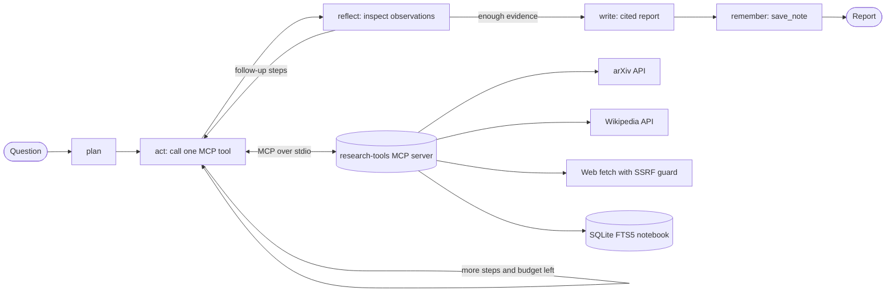

# MCP Research Planner Agent

An agentic research assistant. A **LangGraph** planner decides what to look up, calls its tools through a real **Model Context Protocol (MCP)** server, reflects on what came back, chains follow-up calls, and writes a cited Markdown report. It also remembers its findings for future sessions.

The same MCP server can be plugged into Claude Desktop or any other MCP host, so the tools are reusable on their own.

Free to run: arXiv and Wikipedia need no API keys, the default planner works offline, and an optional local LLM runs through [Ollama](https://ollama.com).

## Problem

"Research this topic for me" is a multi-step job: find background, find recent papers, notice gaps, dig further, then synthesise with sources. Single-shot LLM answers skip the digging and invent citations. Hand-rolled agents usually hard-wire their tools, so nothing is reusable.

## Solution



- **MCP server** (`research_agent/mcp_server.py`) exposes six tools: `search_arxiv`, `search_wikipedia`, `read_wikipedia`, `fetch_url`, `save_note` and `search_notes`. Arguments are validated, and expected failures come back as MCP tool errors rather than crashes.
- **Agent** (`research_agent/agent.py`) is a LangGraph `StateGraph` with *plan → act ⟲ → reflect ⟲ → write → remember*. It discovers its tools dynamically from the MCP `list_tools` response, works within a hard tool-call budget and a limit on reflection rounds, and merges duplicate evidence. When the full article replaces a search snippet, the article text wins.
- **Brains**: the decision policy is pluggable.
  - `heuristic` (default) is deterministic and offline. It splits comparison questions into separate topics while keeping the shared context, so "fine-tuning" is searched as "fine-tuning knowledge LLMs" and not on its own. It checks the notebook first, reads the article that best matches each search's topic, broadens arXiv queries that return too few results, and reads URLs that appear in the question. The report is extractive and fully cited, with sentences picked by Maximal Marginal Relevance.
  - `ollama` lets a local LLM choose tool calls from the MCP tool list using JSON-constrained output. Every decision is validated against the tool's input schema: unknown tools and missing required arguments are rejected, and unknown arguments are stripped. Invented citations are removed. If the model is unreachable or returns something unusable, that step falls back to the heuristic policy and a warning is recorded.
- **Evidence selection**: before writing, off-topic sources are dropped (a search for "fine-tuning" can return "Fine-tuned universe") and the rest are renumbered, so every `[n]` points at a listed source.

## Example

`research-agent "Compare retrieval-augmented generation and fine-tuning for adding knowledge to LLMs" -v`

```
plan: 5 step(s) planned
[ok ] search_notes(...)                                         304 ms
[ok ] search_wikipedia({"query": "retrieval-augmented generation knowledge LLMs"})
[ok ] search_wikipedia({"query": "fine-tuning knowledge LLMs"})
[ok ] search_arxiv({"query": "retrieval-augmented generation knowledge LLMs"})
[ok ] search_arxiv({"query": "fine-tuning knowledge LLMs"})    2991 ms  (arXiv rate limit honoured)
reflect: 2 step(s) planned
[ok ] read_wikipedia({"title": "Retrieval-augmented generation"})
[ok ] read_wikipedia({"title": "Fine-tuning (deep learning)"})
reflect: 1 step(s) planned
[ok ] read_wikipedia({"title": "Knowledge cutoff"})
reflect: 0 step(s) planned
```

The full generated report is in [`examples/rag-vs-fine-tuning.md`](examples/rag-vs-fine-tuning.md). Among other papers, it surfaces *Fine-Tuning or Retrieval? Comparing Knowledge Injection in LLMs*.

## Getting started

```bash
python -m venv .venv && source .venv/bin/activate   # Windows: .venv\Scripts\activate
pip install -e ".[dev]"

research-agent "What is the Model Context Protocol?" -v --out report.md
research-agent "BM25 vs dense retrieval" --json      # report + evidence + full tool trace
```

With a local LLM (optional, free):

```bash
ollama pull llama3.2
research-agent "How do vision transformers handle variable image sizes?" --brain ollama --model llama3.2
```

With Docker:

```bash
docker build -t research-agent .
docker run --rm -v research-data:/app/data research-agent "What is speculative decoding?"
```

### Use the tools from Claude Desktop (or any MCP host)

```json
{
  "mcpServers": {
    "research-tools": {
      "command": "/path/to/.venv/bin/research-mcp-server",
      "env": { "RESEARCH_NOTEBOOK": "/path/to/notebook.db" }
    }
  }
}
```

### Configuration

| Option / env var | Default | Purpose |
|---|---|---|
| `--brain` / `RESEARCH_BRAIN` | `heuristic` | `heuristic` or `ollama` |
| `--model` / `OLLAMA_MODEL` | `llama3.2` | Ollama model |
| `--ollama-url` / `OLLAMA_BASE_URL` | `http://localhost:11434` | Ollama server |
| `--max-steps` | `8` | Hard budget of tool calls (1–30) |
| `--notebook` / `RESEARCH_NOTEBOOK` | `data/notebook.db` | SQLite notebook used for memory |

## MCP tools

| Tool | Arguments | Returns |
|---|---|---|
| `search_arxiv` | `query`, `max_results` (1–20) | papers: title, url, abstract, published, authors |
| `search_wikipedia` | `query`, `max_results` (1–20) | article titles, urls, snippets |
| `read_wikipedia` | `title`, `max_chars` | plain-text article (headings and reference sections removed) |
| `fetch_url` | `url`, `max_chars` | readable text of a public web page |
| `save_note` | `topic`, `content`, `source_url?` | stored note |
| `search_notes` | `query`, `limit` | notes ranked by FTS5 relevance |

## Safety and robustness

- **SSRF protection** in `fetch_url`:
  - Only `http(s)` URLs are allowed, and URLs with embedded credentials are rejected.
  - Every resolved IP must be public, which blocks loopback, private, link-local and cloud-metadata addresses.
  - Redirects are followed manually and re-validated at every hop.
  - Responses are capped at 2 MB, and only HTML or plain text is accepted.
- **FTS5 query injection**: search terms are quoted before they reach `MATCH`.
- **Polite API use**: requests send an identifying User-Agent, and arXiv's one-request-per-3-seconds guideline is enforced by a rate limiter.
- **Bounded autonomy**: there's a hard tool-call budget, a limit on reflection rounds, LangGraph's recursion limit, and duplicate tool calls are refused.

## Testing

```bash
pytest -q
```

33 offline tests: HTTP is mocked with respx, the MCP server runs in-process, and the LLM is mocked. They cover:
- arXiv Atom parsing and query building
- Wikipedia cleanup
- HTML-to-text extraction
- the SSRF guard (5 private address ranges, bad schemes, redirect to an internal host)
- the rate limiter
- planning: comparison splitting and context carry-over
- tool chaining, the budget, broadening after failures, URL following and cross-session memory
- MCP argument validation and FTS injection
- the Ollama brain: schema-validated plans, fallback on bad JSON, invented tools or missing arguments, citation stripping, and Ollama being offline

## Project structure

```
research_agent/
  sources.py     arXiv, Wikipedia, safe web fetch, rate limiting
  notebook.py    SQLite + FTS5 notes (agent memory)
  mcp_server.py  MCP server exposing the tools (stdio)
  toolbox.py     MCP client wrapper: tool discovery and normalised results
  brains.py      heuristic and Ollama policies, extractive report writer
  agent.py       LangGraph state machine
  cli.py         command-line interface
tests/           offline test suite
examples/        sample generated report
```

## Future enhancements

- Semantic re-ranking of evidence with local embeddings
- More MCP tools: Semantic Scholar citations, GitHub code search, PDF full-text reading
- Streamable HTTP transport, so the server can be shared by multiple clients
- A web UI that streams the plan/act/reflect trace live
- An evaluation harness that scores report faithfulness against sources (pairs with the [citation auditor](https://github.com/ashutosh2453/2026-11-15-grounded-rag-citation-auditor))

## License

MIT
